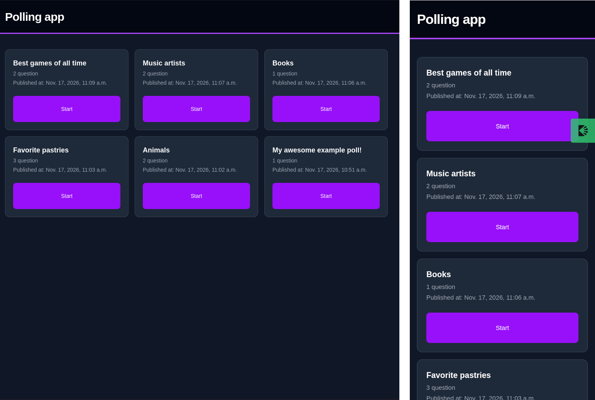
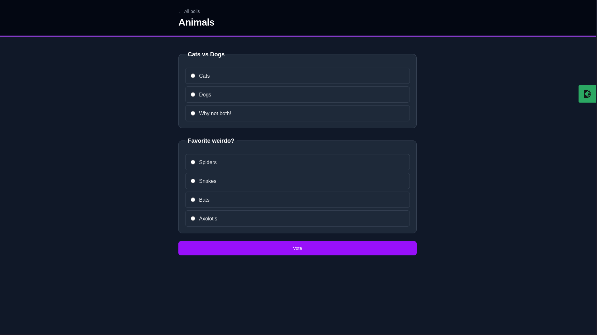
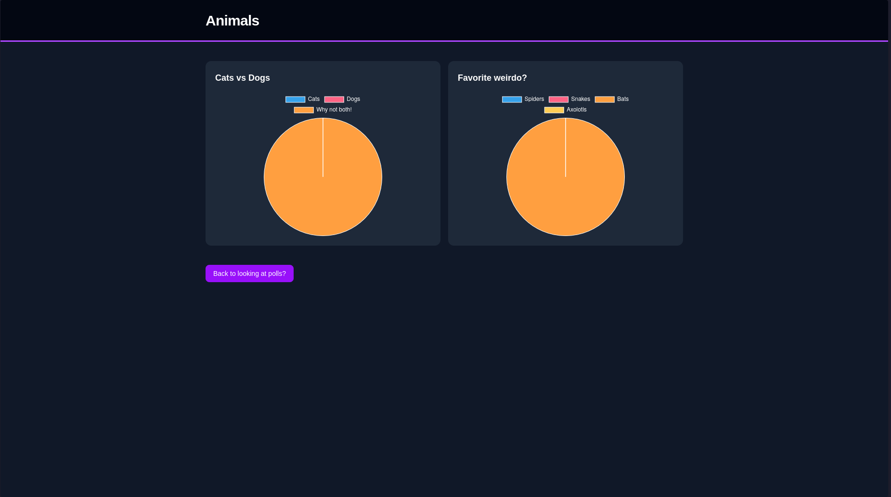
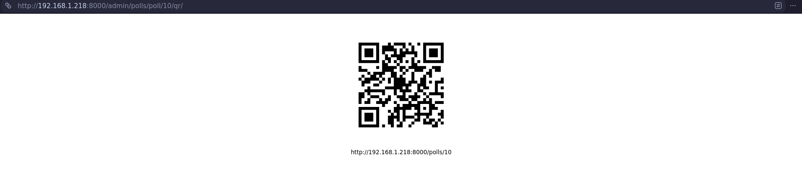

# Polling app
## This is an extended version of the polling app created in the official first Django app tutorial.
### It features:
- Cleaner UI.
- A simplistic way to avoid multiple votes per user.
- Pie charts in the results to show vote spread.
- QR code functionality for easy sharing.
- Support for multiple questions per poll.
- Responsive design using tailwind

## Example use cases:
### Case 1:
You want to collect data through public polls, so you decide to deploy the polling app.
First you'd go to {your site url}/admin to create new polls:

Simply click the add button next to polls on the left. Give the poll a release date, questions and choices, then save!
Do this for any polls you want to make and you'll have a full front page in no time! (Keep in mind that the front page has a poll limit of 6 and future polls aren't shown)

### To users, it would look like so:
Front page:

User picks an available option of their choice and is greeted with the following:

User votes on all available polling questions (in this case why not both and bats respectively) and reaches the results page:

The user then sees pie charts of the resulting polls (in this case with 1 color since they're the first to vote) and is allowed to return to the front page once more.

### Case 2:
You are holding a meeting or presentation, maybe teaching a class.
You want to hold a quick poll for opinions on a certain topic or decision.
You create a poll similarly to case 1 but instead of using the front page and advertising the website. You do this instead:

### After creating a poll:
Go to the polls section of admin (not the add button this time), you see next to each poll there is a show QR code button.

You click it and a QR code pop-up shows up that you can show to anyone in the room:

The QR code redirects to the same view as the user in case 1 after choosing a poll of their choice the rest follows normally.

# Exam app
## What is it:
The above showcased polling app used as the core.
Key differences:
- Exams instead of polls, the questions inside have a single correct answer.
- Exams have deadlines. After the deadline the exam becomes unanswerable and inaccessible.
- Admin page has better tools to view the data.
