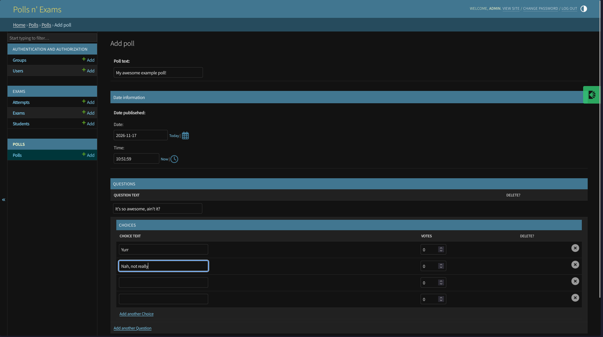
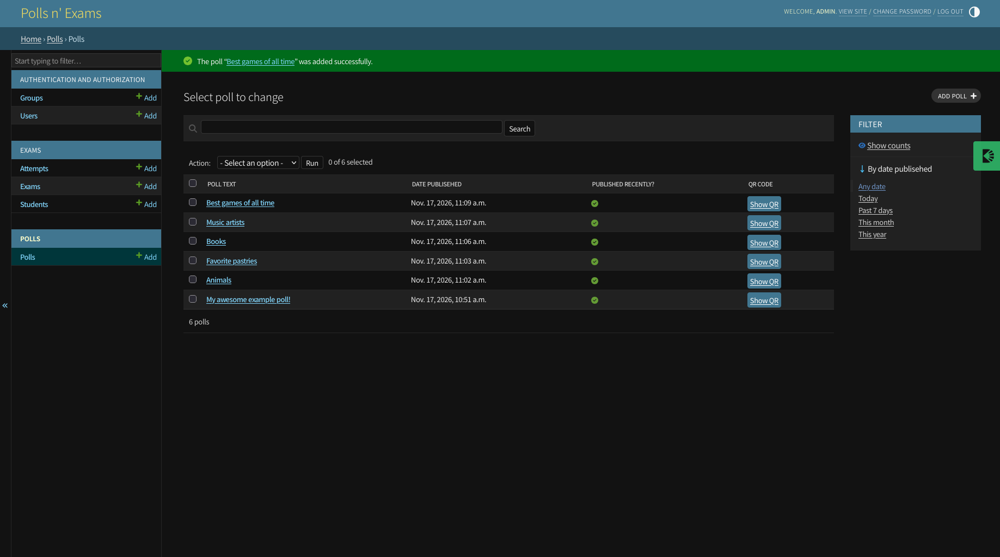
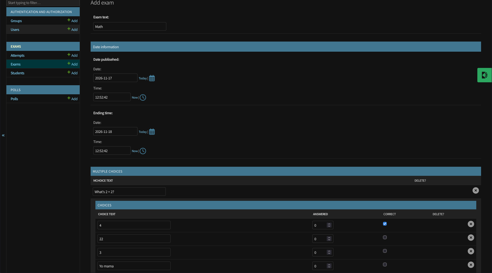
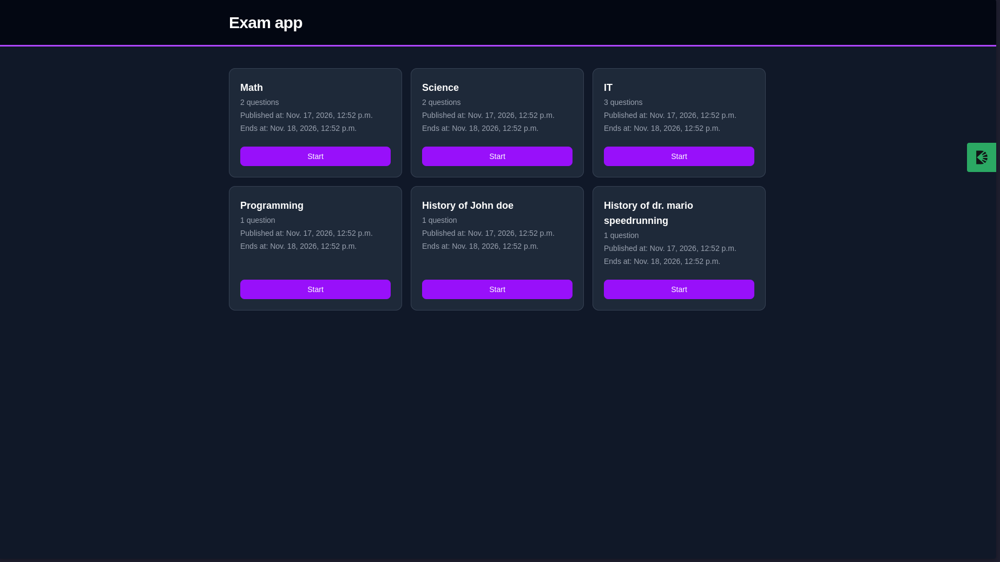
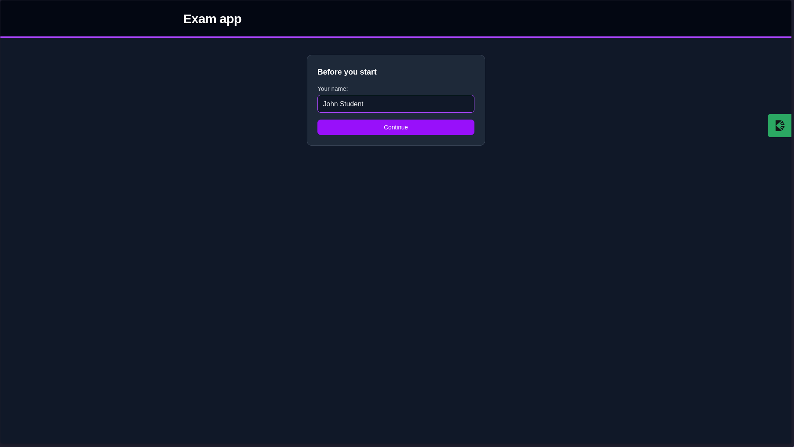
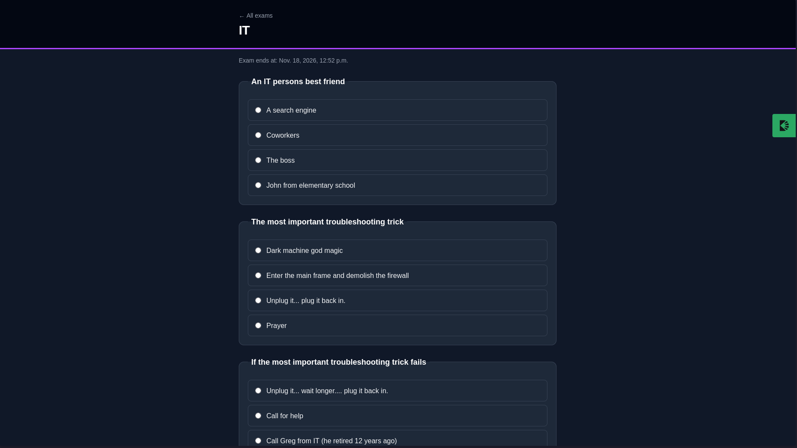
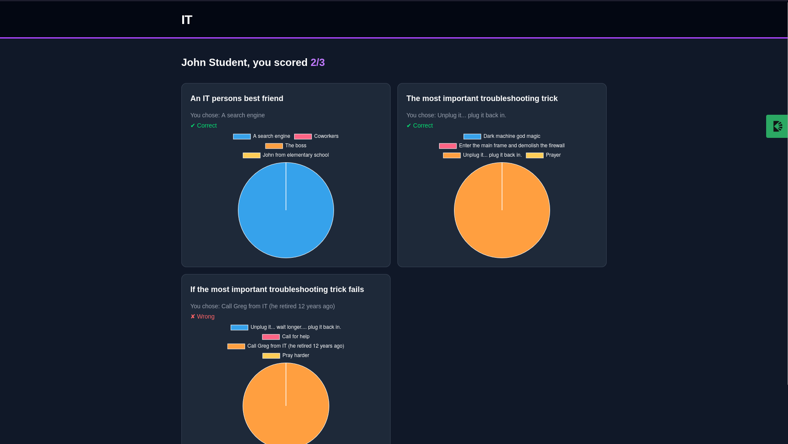
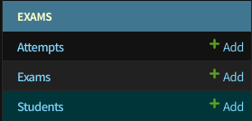

# Polling app
## This is an extended version of the polling app created in the official first Django app tutorial.
### It features:
- Cleaner UI.
- A simplistic way to avoid multiple votes per user.
- Pie charts in the results to show vote spread.
- QR code functionality for easy sharing.
- Support for multiple questions per poll.
- Responsive design using tailwind

## Example use cases:
### Case 1:
You want to collect data through public polls, so you decide to deploy the polling app.
First you'd go to {your site url}/admin to create new polls:

Simply click the add button next to polls on the left. Give the poll a release date, questions and choices, then save!
Do this for any polls you want to make and you'll have a full front page in no time! (Keep in mind that the front page has a poll limit of 6 and future polls aren't shown)

### To users, it would look like so:
Front page:

User picks an available option of their choice and is greeted with the following:

User votes on all available polling questions (in this case why not both and bats respectively) and reaches the results page:

The user then sees pie charts of the resulting polls (in this case with 1 color since they're the first to vote) and is allowed to return to the front page once more.

### Case 2:
You are holding a meeting or presentation, maybe teaching a class.
You want to hold a quick poll for opinions on a certain topic or decision.
You create a poll similarly to case 1 but instead of using the front page and advertising the website. You do this instead:

### After creating a poll:
Go to the polls section of admin (not the add button this time), you see next to each poll there is a show QR code button.

You click it and a QR code pop-up shows up that you can show to anyone in the room:

The QR code redirects to the same view as the user in case 1 after choosing a poll of their choice the rest follows normally.

# Exam app
## What is it:
The above showcased polling app used as the core.
Key differences:
- Exams instead of polls, the questions inside have a single correct answer.
- Exams have deadlines. After the deadline the exam becomes unanswerable and inaccessible.
- Admin page has better tools to view the data.

## Example use cases:
### Case 1:
You're curious on what the knowledge level of the general public is in certain topics. Sure the polling app could be used for this but the feedback is worse and the data is barely collected in comparison. So you decide to deploy the exam app instead.
In a similar fashion to the polling site, you go to {your site url}/admin to create some quick exams:

Very similar to the poll creation UI showcased above, to access it, click the add button next to exam. The main difference here is the addition of correct answers and end dates. The end date determines when the exam cannot be accessed or answered anymore, by default it's 1 day after the opening of the creation form. Each multiple choice question has to have 1 correct answer, no more, no less. The front page limit of 6 applies here too. Though with additional filtering. Not only are future exams inaccessible, but also exams that are past their end date.

### To users it would look like so:
The front page:

As we can see, remarkably similar, except the end_date is shown already. This matters so that if someone visits the page, they avoid being disappointed by the exam becoming unanswerable while they are doing it.
User chooses an exam they want to attempt but they have not yet tried an exam, so they must identify with a username (must be unique):

This is the first completely unique part of the exam version of the app. In the polling app, your cookie is silently given to you with the polls you've answered attached. In the exam app it's tied to a student model which has a name (given in the identification page). This is so someones answers can be traced across multiple exams (for example in a school setting).

After giving yourself a name, you're redirected to the exam you actually chose:

This page is practically identical to the one in the polling app, except for the fact that there is an end date visible. For the same reason as the index page having it.
The user answers the questions to the best of their ability (in this case options 1, 3 and 3):

Once again pie charts with the chosen answers appear, but this time the users score is displayed first so that they knew how well they did alongside the pie charts showing what they chose and if the specific answer was correct or not. Pretty neat, right?

### Back to the admin (you):

Now we have had John Student not only register but answer an exam. What can you see?
Well you may have noticed earlier but this app has more models accessible by the admin: Exam, Student and Attempt. Let's start by looking at Students.

